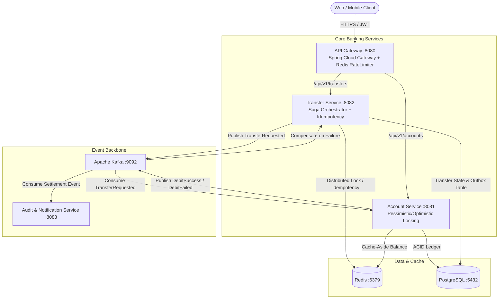

# DBS PayLah / FAST Real-Time Funds Transfer Microservices Plan

> [!IMPORTANT]
> **Target Role:** Senior Java / Spring Boot Developer (7+ YOE) | **Client:** DBS Bank Singapore via IBM  
> **Technical Panel Focus:**
> - **Prabhakara Rao Inapanuri (Lead Architect / 16 YOE):** Spring Boot 3 internals, Concurrency, Concurrency Locks, Kafka Partitioning/EOS, Redis Idempotency, Saga & Outbox, Resilience4j.
> - **Amudha K. (Delivery Tower Lead / 26+ YOE Banking DBS):** Zero-downtime release, Audit ledger integrity, MAS (Monetary Authority of Singapore) FAST SLAs (99.999%), Failure recovery, DLT monitoring.

---

## 1. System Architecture Overview

---

## 2. Technology Stack & Enterprise Standards

| Component | Technology | Enterprise Rationale (What to tell the panel) |
| :--- | :--- | :--- |
| **Language** | Java 21 / 17 | Records for immutable DTOs/Events, pattern matching, Virtual Threads (`spring.threads.virtual.enabled=true`) |
| **Framework** | Spring Boot 3.x | Jakarta EE 10, Spring 6 native observability (Micrometer Tracing + Prometheus) |
| **Data Layer** | Spring Data JPA / Hibernate | Explicit `@Lock(PESSIMISTIC_WRITE)` for balance updates, Hibernate 6 query optimization |
| **Database** | PostgreSQL | Multi-schema ACID compliance, transactional Outbox pattern to prevent dual-write loss |
| **Cache & Lock** | Redis (Lettuce / Redisson) | Redis `SETNX` token bucket idempotency, sub-millisecond balance cache-aside |
| **Event Streaming**| Apache Kafka | Keyed partitioning by `accountId` for sequential ledger ordering, consumer group concurrency |
| **Resilience** | Resilience4j | Circuit Breaker, Bulkhead, TimeLimiter, and Retry on synchronous API calls |
| **Security** | Spring Security 6 (JWT) | Stateless JWT validation at Gateway, verified user/role context propagated down via headers |
| **Containerization**| Docker Compose | Zero-setup reproducible infra: Postgres, Redis, and Kafka (KRaft mode) |

---

## 3. Step-by-Step Code-First Execution Roadmap

### Phase 1: Infrastructure & Project Scaffolding
- [x] Parent Maven POM configuration (`java 21`, `spring-boot 3.3.5`, dependency management).
- [x] Multi-module project structure:
  - `banking-common` (DTOs, Events, Exceptions, Error Codes).
  - `account-service` (Port 8081).
  - `transfer-service` (Port 8082).
  - `notification-service` (Port 8083).
  - `api-gateway` (Port 8080).
- [x] `docker-compose.yml` defining PostgreSQL 16, Redis 7, Kafka (KRaft mode).

### Phase 2: Account Service & High-Concurrency Balance Engine
- [x] **Entity Model:** `Account`, `TransactionLedger` (Immutable audit trail).
- [x] **Concurrency Defense (Crucial Interview Test):**
  - Prevent race conditions during concurrent debits using `@Lock(LockModeType.PESSIMISTIC_WRITE)` (`SELECT ... FOR UPDATE`).
  - Optimistic locking version field (`@Version`).
- [x] **Redis Cache-Aside:** Account balance caching (`@Cacheable`) with cache eviction (`@CacheEvict`) on ledger change.
- [x] REST Endpoints for account creation, balance inquiry, and ledger audit.

### Phase 3: Transfer Service, Idempotency & Saga Workflow
- [x] **Idempotency Engine:**
  - Header/Body: `idempotencyKey` validated in Redis (`SETNX` with 120s TTL).
  - Immediate rejection of duplicate transfer submissions (HTTP 409 Conflict).
- [x] **Transfer State Machine:**
  - `INITIATED` $\rightarrow$ `PENDING_DEBIT` $\rightarrow$ `SETTLED` (or `FAILED` $\rightarrow$ `COMPENSATED`).
- [x] **Transactional Outbox Pattern:**
  - Save `Transfer` and `OutboxEvent` in a single local DB transaction.
  - Scheduled poller/publisher (`OutboxPublisher`) to Kafka topic `transfer-events`.

### Phase 4: Kafka Event-Driven Processing & Resiliency
- [x] Kafka Producer configuration (`acks=all`, `enable.idempotence=true`).
- [x] Kafka Consumer in `account-service` (`TransferEventListener`) with atomic debit/credit execution.
- [x] Dead Letter Topic (`transfer-events.DLT`) handling for poison pill messages via `DeadLetterPublishingRecoverer`.
- [x] Partitioning strategy: Partition key = `sourceAccountNumber` to guarantee sequential ledger ordering.
- [x] Compensation rollback trigger on partial transaction failures.

### Phase 5: API Gateway & Circuit Breakers
- [x] Gateway routing rules forwarding traffic to downstream services.
- [x] Resilience4j Circuit Breaker fallback endpoints (`/fallback/accounts`, `/fallback/transfers`).

### Phase 6: 7+ YOE Technical Interview Defense Drill (Prabhakara & Amudha Focus)
- [x] Documented in [INTERVIEW_DEFENSE_DRILL.md](file:///home/dipak/Pictures/JavaSb/Java-Sb-Exploratory-25-10-26/Projects/INTERVIEW_DEFENSE_DRILL.md):
  - Double-spending defense (Pessimistic lock vs Redis lock vs Optimistic lock).
  - Distributed transactions & dual-write elimination (Saga + Outbox vs 2PC).
  - Kafka in-order processing & Exactly-Once Semantics (EOS).
  - Redis Cache-Aside consistency (why evict instead of update).
  - Spring Boot 3 & Java 21 internals (Virtual threads, `@Transactional` proxy caveats).
  - Banking reliability, MAS 99.999% SLA compliance, and DLT monitoring.
